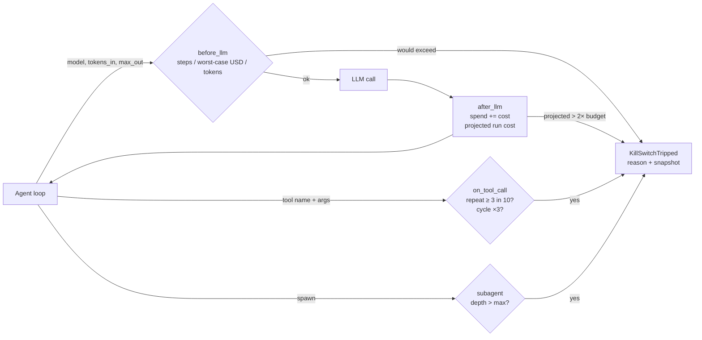

# cost-kill-switch

Middleware that sits between an agent loop and its LLM/tool calls, tracks loop depth, steps, tokens, spend and projected run cost, and halts the run **before** a call that would break a budget. Tested against a set of simulated runaway agents (repeat loops, oscillation, context bloat, recursive sub-agent spawning).

## What it is
- `killswitch/guard.py` — `RunGuard` with hooks `before_llm` (pre-flight worst-case check), `after_llm` (accounting + projection), `on_tool_call` (repeat and cycle detection) and `subagent()` (depth tracking). `guarded(guard, llm_fn)` wraps any LLM function.
- `killswitch/simulator.py` — five deterministic SIMULATED agents and a `NullGuard` baseline that records spend but never stops anything.
- `bench/run_sim.py` — runs every agent with and without the kill switch.

## Why
Agent loops fail expensively. A tool keeps timing out and the agent retries it forever. Each step appends a tool result to the context, so input tokens and cost grow every turn. A planner spawns sub-agents that spawn sub-agents. A post-hoc billing alert fires after the money is gone; this guard refuses the next call instead.

## Architecture


## How it works
| Trip reason | Rule (defaults) |
|---|---|
| `budget_usd` | spent + worst-case cost of the next call (`tokens_in`, `max_out`) > `max_usd` (1.00) |
| `max_steps` | next LLM call would be step 51 |
| `max_tokens` | cumulative tokens + next call's worst case > 500,000 |
| `projected_cost` | after ≥ 3 steps, spent + avg-cost-per-step × remaining steps > 2 × `max_usd` |
| `repeat_tool_call` | same tool name + same args (key-order-insensitive hash) seen 3× in the last 10 calls |
| `tool_cycle` | a sequence of 2–4 calls repeats 3× back to back |
| `max_depth` | sub-agent nesting > 3 |

Once tripped, every later hook re-raises, so a caught exception cannot revive the run.

## Results
### Runaway-agent simulation — SIMULATED
Run: `python3 bench/run_sim.py`. Raw output: [`results/simulation.json`](results/simulation.json).

Agents and token counts are deterministic formulas, and prices are **illustrative** (USD per 1M tokens: large 15/75, medium 3/15, small 0.25/1.25), not any vendor's price list. The guard is the real code. Budget: $1.00, 50 steps, depth 3. Unguarded runs stop at a 200-step ceiling so the simulation ends.

| Agent | Without kill switch | With kill switch | Trip reason |
|---|---|---|---|
| healthy (6 steps) | completed, $0.099 | completed, $0.099 | — (no false stop) |
| runaway_repeat (same failing fetch) | 200 steps, $3.00 | 3 steps, $0.045 | `repeat_tool_call` |
| oscillate (open/close same file) | 200 steps, $0.225 | 5 steps, $0.0056 | `repeat_tool_call` |
| context_bloat (+6k tokens per step, large model) | 200 steps, $1,809.00 | 3 steps, $0.54 | `projected_cost` |
| recursive_spawn (each agent spawns 2) | 127 steps, $1.524, depth 7 | 3 steps, $0.036 | `max_depth` |

In every guarded run spend stayed under the $1.00 budget, and the healthy agent was not stopped. These numbers show the guard's logic on synthetic loops; they are not measurements of a real agent or real bills.

## Tests
19 tests (`pytest`): cost math, accounting, pre-flight budget block (never overspends), max steps, max tokens, projected-cost trip and formula, repeat detection (and no trip for different args, key-order insensitivity), cycle detection, depth limit with depth restored, tripped-stays-dead, healthy agent untouched, four runaway agents halted within budget, and the unguarded baseline overspending.

```
$ python3 -m pytest -q
...................                                                      [100%]
19 passed in 0.04s
```

## Run it
```bash
pip install pytest
python3 -m pytest -q
python3 bench/run_sim.py
```

## Limits
- Pure Python library, sync hooks. No async wrapper, no framework adapters (LangGraph, OpenAI Agents SDK, etc.) yet.
- Pre-flight uses the caller's `max_out`; if the caller passes no output cap, the worst case is unknown.
- Token counts come from the caller. No tokenizer is bundled.
- Repeat detection is exact-match on args; a loop that changes one irrelevant arg (a timestamp) evades it, though the step, projection and budget limits still apply.
- State is per process and per run. No shared org-wide budget or persistence.
- Prices are illustrative placeholders.

## Stack
Python 3.12 · standard library only · pytest

## License
MIT
